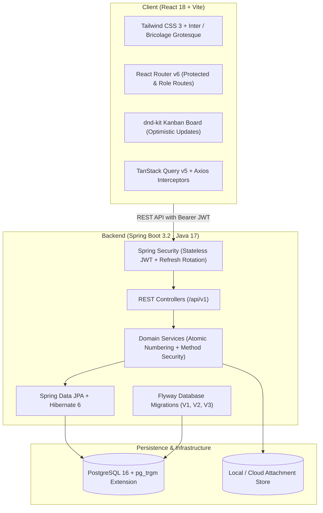

# Fixlane

**Enterprise-Grade Issue Tracking System**  
Engineered for Velocity — Strict Role-Based Governance, Zero Bloat.
Built with Java 17, Spring Boot 3.2, PostgreSQL, Flyway, React 18, Vite, Tailwind CSS 3, and dnd-kit.

---

##  Live Demo & Credentials

| Role | Email | Password | Permissions Summary |
|---|---|---|---|
| **Admin** | `admin@fixlane.dev` | `Admin1234!` | Full control: create/manage projects, change user roles, edit/delete any issue |
| **Manager** | `manager@fixlane.dev` | `Manager1234!` | Manage projects, invite members, assign issues, edit/delete issues |
| **Developer** | `dev1@fixlane.dev` | `Dev12345!` | View projects, create issues, self-assign, move assigned issues, comment |
| **Developer** | `dev2@fixlane.dev` | `Dev12345!` | Same as dev1 |
| **Developer** | `dev3@fixlane.dev` | `Dev12345!` | Same as dev1 |

*The database automatically seeds 5 users, 2 projects (`PAY` and `WEB`), and 20 realistic issues on initial startup.*

---

##  Architecture & System Design



---

##  Design System & Tokens

Fixlane uses a calm, precision engineering-grade aesthetic inspired by Linear and refined devtools.

- **Background:** `#F4F5F2` | **Surface:** `#FFFFFF` | **Column Background:** `#EAEDE8`
- **Ink (Text):** `#15211C` | **Muted Text:** `#4A5852` | **Subtle:** `#5B6963`
- **Primary:** `#0B6E5B` (Dark Emerald) | **Primary Tint:** `#E3F1ED` | **Primary Ink:** `#0B5A4A`
- **Danger:** `#A52E18` | **Danger Tint:** `#FBE4DE`
- **Border:** `#DDE1DC` | **Input Border:** `#AEB8B1`
- **Typography:**
  - Headings: `Bricolage Grotesque` (600/700, tight tracking `-0.03em`)
  - Body & UI: `Inter` (400/500/600)
  - Issue Keys: `JetBrains Mono` (500)

---

##  Permissions Matrix

Method-level authorization is enforced on the server via `SecurityConfig` and service assertions:

| Action | Admin | Manager | Developer |
|---|:---:|:---:|:---:|
| **Create projects** | Yes | Yes | No (403) |
| **Add / remove members** | Yes | Yes | No (403) |
| **Create issues** | Yes | Yes | Yes |
| **Assign issues** | Yes | Yes | Self only |
| **Move issues on Kanban board** | Yes | Yes | Assigned only |
| **Edit / delete issues** | Yes | Yes | Reporter only |
| **Change member roles** | Yes | No (403) | No (403) |

---

##  Quick Start Guide

### Option 1: Docker Compose (Full Stack in 1 Command)

Ensure Docker Desktop is running, then run:

```bash
cd fixlane
docker-compose up --build
```

- **Frontend:** [http://localhost:5173](http://localhost:5173)
- **Backend API:** [http://localhost:8080/api/v1](http://localhost:8080/api/v1)
- **Swagger UI:** [http://localhost:8080/swagger-ui.html](http://localhost:8080/swagger-ui.html)
- **Database:** PostgreSQL on `localhost:5432`

---

### Option 2: Local Development

#### Prerequisites
- Java 17+ & Maven 3.9+
- Node.js 18+ & pnpm (`npm install -g pnpm`)
- PostgreSQL 14+ running locally

#### 1. Database Setup
Create database `fixlane`:
```sql
CREATE DATABASE fixlane;
```

#### 2. Backend Setup
```bash
cd fixlane/backend
# Configure src/main/resources/application.yml or set env vars:
mvn spring-boot:run
```
Flyway will automatically run migrations `V1__init_schema.sql`, `V2__projects_issues.sql`, and `V3__comments_attachments.sql`. On first run, `SeedDataRunner` populates demo users and projects.

#### 3. Frontend Setup
```bash
cd fixlane/frontend
pnpm install
pnpm run dev
```
Open [http://localhost:5173](http://localhost:5173) in your browser.

---

## REST API Documentation

All endpoints are prefixed with `/api/v1` and return JSON. Interactive Swagger UI is available at `/swagger-ui.html`.

### Authentication (`/auth`)
| Method | Endpoint | Description | Auth Required |
|---|---|---|---|
| `POST` | `/auth/register` | Register new account (Developer role) | No |
| `POST` | `/auth/login` | Sign in, receive access + refresh token | No |
| `POST` | `/auth/refresh` | Rotate refresh token for a new token pair | No (Refresh Token) |
| `POST` | `/auth/logout` | Revoke active refresh token | Yes |
| `GET` | `/auth/me` | Current authenticated user profile | Yes |

### Projects (`/projects`)
| Method | Endpoint | Description | Permitted Roles |
|---|---|---|---|
| `GET` | `/projects` | List projects user belongs to | Any authenticated |
| `GET` | `/projects/{id}` | Get project details by UUID | Project Member / Admin |
| `POST` | `/projects` | Create new project with 2-4 letter key | Admin, Manager |
| `PUT` | `/projects/{id}` | Update project description or lead | Admin, Manager |
| `DELETE`| `/projects/{id}` | Delete project and all associated issues | Admin |
| `GET` | `/projects/{id}/members` | List members of project | Any authenticated |
| `POST` | `/projects/{id}/members` | Add user to project | Admin, Manager |
| `DELETE`| `/projects/{id}/members/{userId}` | Remove user from project | Admin, Manager |

### Issues (`/issues` and `/projects/{id}/issues`)
| Method | Endpoint | Description | Permitted Roles |
|---|---|---|---|
| `GET` | `/projects/{id}/issues` | List & filter issues (`q`, `status`, `priority`, `mine`) | Project Member |
| `POST` | `/projects/{id}/issues` | Create new issue (atomic numbering `KEY-N`) | Project Member |
| `GET` | `/issues/{key}` | Get issue by key (e.g. `PAY-1`) | Project Member |
| `PUT` | `/issues/{key}` | Edit title, description, priority, due date | Admin, Manager, Reporter |
| `DELETE`| `/issues/{key}` | Delete issue | Admin, Manager, Reporter |
| `PATCH`| `/issues/{key}/status` | Move card on board (`TODO`, `IN_PROGRESS`, `DONE`) | Admin, Manager, Assignee |
| `PATCH`| `/issues/{key}/assignee` | Assign issue | Admin, Manager, Self |
| `POST` | `/projects/{id}/issues/reorder` | Update card order indices for Kanban drag | Project Member |

### Comments & Attachments
| Method | Endpoint | Description | Permitted Roles |
|---|---|---|---|
| `GET` | `/issues/{key}/comments` | List comment thread | Project Member |
| `POST` | `/issues/{key}/comments` | Add comment | Project Member |
| `DELETE`| `/comments/{id}` | Delete comment | Author, Admin |
| `POST` | `/issues/{key}/attachments` | Upload image (max 5MB) | Project Member |
| `GET` | `/attachments/{id}` | Download attachment resource | Project Member |

### Dashboard & Team
| Method | Endpoint | Description | Permitted Roles |
|---|---|---|---|
| `GET` | `/dashboard/summary` | Stats tiles, sprint progress, priority counts, activity | Authenticated |
| `GET` | `/users` | List team members in organization | Authenticated |
| `PATCH`| `/users/{id}/role` | Promote/demote user (`ADMIN`, `MANAGER`, `DEVELOPER`) | Admin |
| `POST` | `/users/invite` | Invite new user by email and assign role | Admin, Manager |

---

## Testing

The repository contains unit tests, Spring WebMvc controller slice tests, and service tests:

```bash
cd fixlane/backend
mvn test
```

Frontend type-check & lint:
```bash
cd fixlane/frontend
pnpm run lint
```

---

## Production Deployment

### Backend (Render / Railway)
1. Fork or push this repository to GitHub.
2. In **Render**, create a **PostgreSQL** database service and a **Web Service**.
3. Set Web Service Root Directory to `backend`.
4. Configure Environment Variables:
   - `DATABASE_URL`: `jdbc:postgresql://<host>:<port>/<db>`
   - `DB_USER`: `<user>`
   - `DB_PASS`: `<password>`
   - `JWT_SECRET`: Random 256-bit secret string (Base64 or 32+ characters)
   - `CORS_ORIGIN`: Your production frontend URL (e.g. `https://fixlane.vercel.app`)
5. Build Command: `mvn clean package -DskipTests`
6. Start Command: `java -jar target/*.jar`

### Frontend (Vercel / Netlify)
1. In **Vercel**, import your GitHub repository.
2. Set Root Directory to `frontend`.
3. Framework Preset: `Vite`.
4. Set Environment Variable:
   - `VITE_API_URL`: `https://your-backend-service.onrender.com/api/v1`
5. Deploy. `vercel.json` ensures client-side routing routes correctly to `/index.html`.

---

## License
MIT License. Built for high-velocity software engineering teams.
